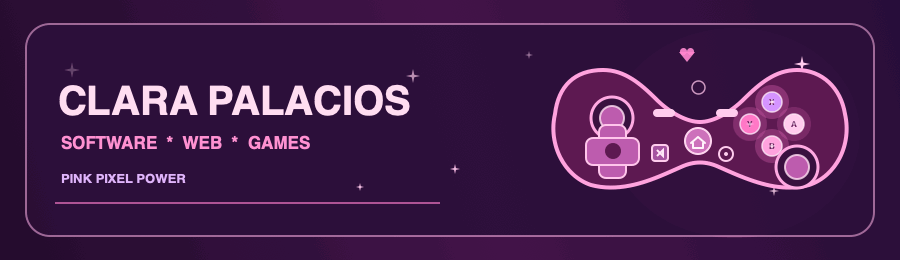

[Portfolio](https://clarapalacios.netlify.app) · [LinkedIn](https://www.linkedin.com/in/clara-palacios1990/) · [Play Sharky Dash](https://kitsune-pixel-works.itch.io/sharky-dash)

---

## Hey, I'm Clara! 🎮💗

I'm an Information Science & Technology student. I like building software, web projects, and games while learning how things work. Right now, I'm focusing on Python, backend development, APIs, and AI/ML application development.

### ✨ My current toolkit

### 🎮 Project quest log

| Project | What I'm making |
| --- | --- |
| [My portfolio](https://clarapalacios.netlify.app) | My software, web, and game projects in one place. |
| [Sharky Dash](https://kitsune-pixel-works.itch.io/sharky-dash) | An 8-bit underwater arcade game. **Play it on itch.io.** |
| [Ronin Together](https://clarapalacios.netlify.app/#work) | A browser-based cooperative survival game. Project details are on my portfolio. |
| Dino App | My app with assistants for front-end work, back-end work, and code review. |
| Python Cheat Sheet Widget | A macOS widget project with quick Python reminders and examples, built in VS Code using SwiftUI. |
| [Planner](https://github.com/clarapalacios025/planner) | A personal planner project in progress. |
| [Looking Good Med Spa website](https://clarapalacios.netlify.app/#work) | A website design project featured in my portfolio. |

### 🌸 What I'm learning now

Python, backend development, APIs, and AI/ML application development.

💖 Thanks for stopping by! Keep leveling up. 💖

