[Portfolio](https://clarapalacios.netlify.app) · [LinkedIn](https://www.linkedin.com/in/clara-palacios1990/) · [Play Sharky Dash](https://kitsune-pixel-works.itch.io/sharky-dash)

---

## Hi, I'm Clara

I'm an Information Science & Technology student at William Paterson University, working toward software engineering, web development, and game development. I like figuring out how systems fit together, and most of what I build sits somewhere between software, the web, and games. These days I'm spending most of my time on Python, backend work, APIs, and building applications with AI/ML.

### Toolkit

### Software

| Project | About |
| --- | --- |
| Python Cheat Sheet Widget | A macOS widget with quick Python reminders and examples, written in SwiftUI. |
| Dino App | An app with built-in assistants for front-end work, back-end work, and code review. |
| [Planner](https://github.com/clarapalacios025/planner) | A personal planner I'm still building. |

### Web

| Project | About |
| --- | --- |
| [Portfolio](https://clarapalacios.netlify.app) | My software, web, and game work in one place. |
| [Looking Good Med Spa](https://clarapalacios.netlify.app/#work) | A website design for a med spa, featured in my portfolio. |

### Games

| Project | About |
| --- | --- |
| [Sharky Dash](https://kitsune-pixel-works.itch.io/sharky-dash) | An 8-bit underwater arcade game. You can play it on itch.io. |
| [Ronin Together](https://clarapalacios.netlify.app/#work) | A cooperative survival game that runs in the browser. More details on my portfolio. |

### Currently learning

Python, backend development, APIs, AI/ML applications, web development, and game development.

---

## GitHub stats

## Contributions

Thanks for stopping by.

